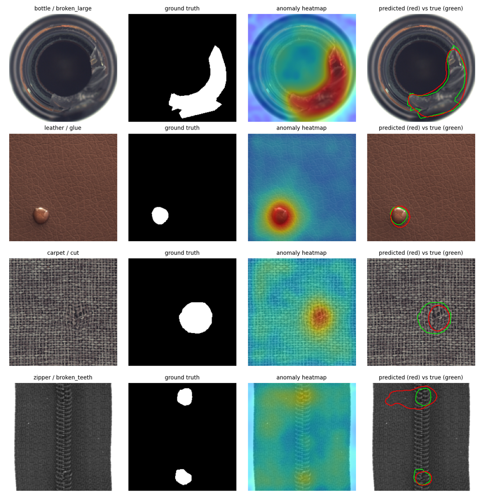
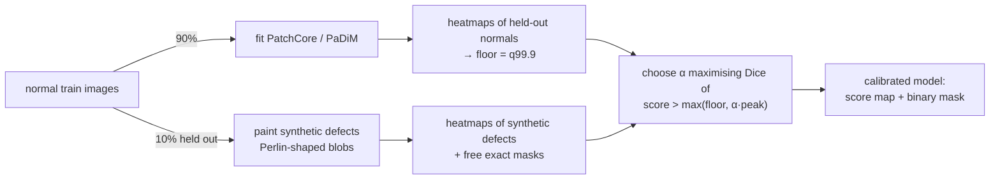
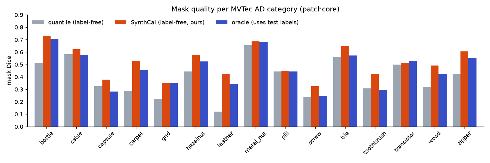

# MaskSight

[](https://github.com/Sarthakkar23/MaskSight/actions/workflows/ci.yml)
 

**Label-free defect segmentation.** MaskSight learns what a *good* product looks like from normal images
only, then predicts a pixel-level mask of anything that deviates: scratches, cracks, contamination,
missing parts. It never sees a defect label, not even to choose the threshold that turns a heatmap
into a mask.



**Headline result** (all 15 MVTec AD categories, PatchCore backbone): label-free mask Dice rises from
**0.397 → 0.517 (+30%)** with SynthCal. That is *higher* than the 0.466 of an "oracle" threshold tuned on
the real test labels. SynthCal beats the label-free baseline on **15/15** categories.

## The problem

Unsupervised anomaly detectors (PatchCore, PaDiM, …) are excellent at *ranking* pixels: pixel AUROC
is about 0.98. A production line needs a **binary mask**, though, and a mask needs a threshold.
Papers usually pick it on the labelled test set. A real deployment can't do that, and the honest
label-free alternative (a high quantile of normal-image scores) produces poor masks: Dice 0.12 on
leather, 0.22 on grid.

## SynthCal: peak-relative calibration on synthetic defects



1. Hold out 10% of the normal training images.
2. Paint synthetic defects on them: Perlin-noise shapes, kept to 1–2 connected regions and placed
   on the object's foreground. They are filled with colour-jittered foreign texture, displaced
   structure, or a stain. The exact mask comes for free.
3. A pixel is defective if `score > floor` **and** `score > α · max(score in this image)`. The `floor`
   is the 99.9th percentile of normal-pixel scores, so clean parts stay clean.
4. Choose **α** to maximise Dice on the synthetic defects.

**Why relative?** Synthetic defects are never exactly as conspicuous as real ones. A pasted foreign
texture on carpet is far louder than a real thread defect, so an *absolute* threshold learned on
them transfers badly. The "synth-abs" column below is *worse* than the baseline. The *shape* of a
defect's response (how quickly the heatmap falls off from its peak) depends on the backbone's
receptive field and the smoothing, not on how strong the defect is. So α transfers: averaged
over categories, the α learned on synthetic defects is 0.05 away from the α tuned on real labels.

## Results

MVTec AD, all 15 categories, WideResNet-50 features, one free Colab T4. **Every threshold except
"oracle" is label-free.** "synth-abs" is the naive variant (an absolute threshold fit on synthetic
defects); "oracle" is an absolute threshold tuned on the real test masks.



| Method | Image AUROC | Pixel AUROC | AUPRO | Dice: quantile | Dice: synth-abs | **Dice: SynthCal** | Dice: oracle | Image F1 (label-free) | Latency (T4) |
|---|---|---|---|---|---|---|---|---|---|
| padim | 0.986 | 0.975 | 0.895 | 0.366 | 0.321 | **0.480** | 0.432 | 0.893 | 16 ms |
| patchcore | 0.990 | 0.978 | 0.907 | 0.397 | 0.369 | **0.517** | 0.466 | 0.882 | 29 ms |

- padim: SynthCal beats the quantile baseline on 15/15 categories and matches or beats the oracle on 11/15.
- patchcore: SynthCal beats the quantile baseline on 15/15 categories and matches or beats the oracle on 13/15.

- With the peak-relative rule, the best possible α (tuned on test labels) gives Dice 0.537 (PatchCore) /
  0.501 (PaDiM). SynthCal reaches **96% of that** without labels. The learned α is on average 0.05 away
  from the label-tuned α.

<details><summary>Per-category results</summary>

| Category | padim: img AUROC | patchcore: img AUROC | padim: AUPRO | patchcore: AUPRO | padim: Dice q | patchcore: Dice q | padim: **Dice SC** | patchcore: **Dice SC** | padim: Dice oracle | patchcore: Dice oracle |
|---|---|---|---|---|---|---|---|---|---|---|
| bottle | 1.000 | 1.000 | 0.905 | 0.926 | 0.471 | 0.513 | 0.696 | 0.729 | 0.673 | 0.707 |
| cable | 0.993 | 0.996 | 0.913 | 0.918 | 0.562 | 0.584 | 0.609 | 0.624 | 0.555 | 0.577 |
| capsule | 0.939 | 0.972 | 0.902 | 0.909 | 0.333 | 0.326 | 0.369 | 0.377 | 0.230 | 0.283 |
| carpet | 0.995 | 0.988 | 0.908 | 0.922 | 0.220 | 0.286 | 0.509 | 0.529 | 0.411 | 0.457 |
| grid | 0.981 | 0.987 | 0.900 | 0.902 | 0.232 | 0.223 | 0.352 | 0.349 | 0.280 | 0.352 |
| hazelnut | 1.000 | 1.000 | 0.869 | 0.859 | 0.406 | 0.444 | 0.564 | 0.577 | 0.497 | 0.523 |
| leather | 1.000 | 1.000 | 0.955 | 0.967 | 0.088 | 0.122 | 0.382 | 0.425 | 0.289 | 0.347 |
| metal_nut | 1.000 | 0.998 | 0.882 | 0.920 | 0.574 | 0.657 | 0.613 | 0.685 | 0.662 | 0.684 |
| pill | 0.965 | 0.960 | 0.933 | 0.919 | 0.387 | 0.444 | 0.400 | 0.450 | 0.417 | 0.443 |
| screw | 0.954 | 0.985 | 0.934 | 0.950 | 0.190 | 0.239 | 0.268 | 0.326 | 0.239 | 0.247 |
| tile | 0.992 | 0.990 | 0.771 | 0.812 | 0.473 | 0.564 | 0.502 | 0.647 | 0.507 | 0.573 |
| toothbrush | 1.000 | 0.997 | 0.853 | 0.863 | 0.242 | 0.308 | 0.389 | 0.426 | 0.276 | 0.295 |
| transistor | 1.000 | 1.000 | 0.949 | 0.947 | 0.511 | 0.500 | 0.514 | 0.511 | 0.584 | 0.528 |
| wood | 0.995 | 0.990 | 0.836 | 0.857 | 0.296 | 0.319 | 0.458 | 0.491 | 0.365 | 0.424 |
| zipper | 0.976 | 0.992 | 0.915 | 0.925 | 0.511 | 0.425 | 0.574 | 0.604 | 0.497 | 0.551 |

</details>

### Ablations

Averaged over bottle, carpet, hazelnut, leather, screw (PatchCore).

| Variant | Image AUROC | AUPRO | Dice: quantile | **Dice: SynthCal** | Dice: oracle | Fit time | Latency |
|---|---|---|---|---|---|---|---|
| baseline (σ=4, 10%, layer2+3) | 0.995 | 0.925 | 0.321 | **0.517** | 0.456 | 58 s | 32 ms |
| sigma0 | 0.993 | 0.926 | 0.334 | **0.518** | 0.465 | 58 s | 31 ms |
| sigma2 | 0.994 | 0.926 | 0.330 | **0.520** | 0.464 | 57 s | 32 ms |
| sigma8 | 0.995 | 0.919 | 0.294 | **0.499** | 0.436 | 57 s | 36 ms |
| coreset1pct | 0.992 | 0.921 | 0.311 | **0.514** | 0.456 | 15 s | 15 ms |
| coreset25pct | 0.995 | 0.924 | 0.321 | **0.514** | 0.452 | 128 s | 63 ms |
| layer2only | 0.988 | 0.942 | 0.427 | **0.554** | 0.530 | 57 s | 14 ms |
| resnet18 | 0.990 | 0.921 | 0.346 | **0.523** | 0.461 | 56 s | 10 ms |

Takeaways: memory-bank size barely matters for accuracy (1% of patches matches 10%, at half the
latency), heavy smoothing hurts, and **layer2-only features give the sharpest masks** (Dice 0.554) and
the lowest latency. SynthCal's gain holds for every variant, including ResNet-18 (3× faster).

## What's inside

| | |
|---|---|
| [`masksight/models/patchcore.py`](masksight/models/patchcore.py) | PatchCore from scratch: WideResNet-50 patch features, greedy k-center coreset with random projection, chunked GPU nearest-neighbour search |
| [`masksight/models/padim.py`](masksight/models/padim.py) | PaDiM from scratch: per-position Gaussian, shifted streaming covariance, Mahalanobis scoring |
| [`masksight/synth.py`](masksight/synth.py) | Perlin-noise defect generator with foreground-aware placement |
| [`masksight/calibrate.py`](masksight/calibrate.py) | quantile / synth-abs / **SynthCal** / oracle thresholds, image threshold via Youden's J |
| [`masksight/metrics.py`](masksight/metrics.py) | image & pixel AUROC, **AUPRO** (region-wise, GPU), Dice / IoU / pixel F1 |
| [`masksight/benchmark.py`](masksight/benchmark.py) | YAML-driven, resumable benchmark (survives Colab disconnects) |
| [`serve/api.py`](serve/api.py), [`Dockerfile`](Dockerfile) | FastAPI service: `/predict` returns score, verdict and mask |
| [`app/app.py`](app/app.py) | Gradio app for trying models locally |
| [`tests/`](tests), [CI](.github/workflows/ci.yml) | CPU unit + end-to-end tests, ruff, GitHub Actions |
| [`notebooks/`](notebooks) | Colab benchmark runner and the original prototype |

## Quickstart

```bash
pip install -e ".[data,dev]"
masksight download --root data/mvtec --categories bottle
masksight fit --category bottle --data-root data/mvtec --out models/bottle.pt
masksight predict models/bottle.pt data/mvtec/bottle/test/broken_large/000.png
```

Reproduce every number in this README (GPU recommended; [`notebooks/colab_benchmark.ipynb`](notebooks/colab_benchmark.ipynb) runs it on a free T4):

```bash
masksight benchmark configs/main.yaml --data-root data/mvtec
masksight benchmark configs/ablation.yaml --data-root data/mvtec
python scripts/make_report.py results/main/results.csv results/ablation/results.csv
```

Serve and demo:

```bash
MASKSIGHT_MODELS=models uvicorn serve.api:app --port 8000
curl -F image=@part.png "localhost:8000/predict?category=bottle"
python app/app.py
```

## Limitations

- Masks come from a 28×28 feature grid that is upsampled, so thin defects (scratches, cut leads)
  come out blobby. Mask Dice is still far from what supervised segmentation gets with labels.
- Screw, capsule and grid remain hard: small defects on highly variable textures.
- The synthetic-defect generator is hand-designed. Categories where real defects look nothing like
  it (e.g. missing parts on transistor) gain the least.

## Data and licence

Code: MIT. Benchmark data: [MVTec AD](https://www.mvtec.com/company/research/datasets/mvtec-ad)
(Bergmann et al., CVPR 2019 / IJCV 2021), CC BY-NC-SA 4.0; demo models and example images inherit
that licence. PatchCore (Roth et al., CVPR 2022) and PaDiM (Defard et al., ICPR 2021) are
re-implemented from their papers.
